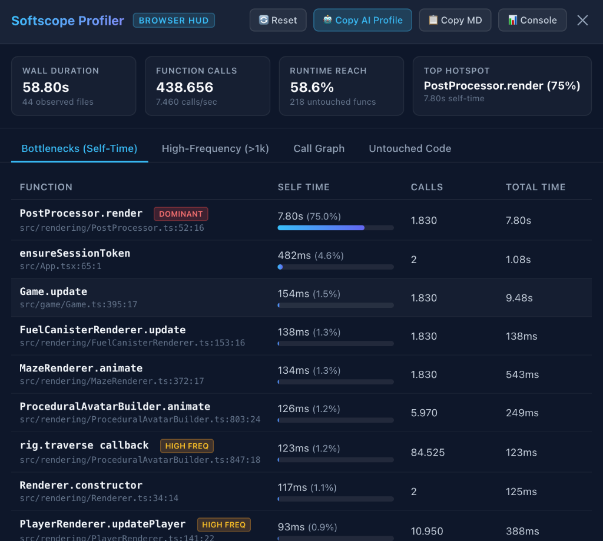

# softscope

> **What is Softscope?**  
> Softscope is a lightweight, zero-configuration runtime micro-profiler for Node.js. It provides microscopic function-level observability into what actually happens inside your JavaScript/TypeScript code while executing **benchmarks, micro-benchmarks, test suites, and scripts**.

---

### What Problem Does It Solve & Why Was It Built?

When writing performance-critical code or benchmarking (using tools like Mitata, Tinybench, Vitest Bench, or custom test harnesses), you typically receive only **macroscopic numbers**: operations per second (`ops/sec`) or total loop elapsed time.

However, standard benchmark runners leave essential questions unanswered:
- **Where was the time actually spent?** Was it inside the algorithm itself (*Self Time*), or inside downstream utility calls and callbacks (*Total Time*)?
- **How many times was each function invoked?** Are there hidden redundant operations, unintended loop iterations, or unexpected quadratic invocation counts?
- **Who called whom?** What does the real runtime caller-callee call graph look like?
- **Did the benchmark actually reach the code?** Did execution hit all target functions and branches, or did parts remain completely untouched (*Runtime Reach*)?

Traditional profilers require heavy sampling configurations, native C++ extensions, source code annotations, or exporting multi-megabyte V8 CPU profile dumps to inspect inside Chrome DevTools.

**Softscope was built to make function-level profiling instant, automatic, and zero-overhead:**
- **Zero code changes**: Prepend `softscope` to your execution command (`softscope bench/run.js` or `softscope npm test`).
- **Surgical AST instrumentation**: Uses the ultra-fast Rust-based `oxc-parser` to discover and wrap functions on-the-fly via native ESM/CJS hooks.
- **Microscopic insights**: Measures exact call counts, total duration, self-duration (exclusive of child calls), and min/avg/max latencies.
- **Multiple views**: Interactive ANSI terminal dashboard (`--tui`), formatted terminal tables, GitHub Flavored Markdown (`--md`) for CI PR comments, or versioned JSON (`--json`).
- **Transparent execution**: Preserves `argv`, `cwd`, `stdin`, `stdout`, `stderr`, environment variables, signal handling (`SIGINT`, `SIGTERM`), and exit codes.

---

## Quick Start

Run any benchmark script, Node.js file, or npm/CLI command through Softscope:

```bash
# Profile benchmark suites with function-level metrics
softscope bench/run.js
softscope node bench/algorithm.js --md

# Works seamlessly with benchmark harnesses (Mitata, Tinybench, custom scripts)
softscope node bench.js
softscope bench/algo.bench.js --md

# Or CLI-based runners (e.g. Vitest Bench, npm test)
softscope npx vitest bench
softscope npm run bench

# Or profile any script, test, or build command
softscope app.js
softscope npm test
softscope npm run build
```

Softscope is transparent to the child process, preserving `argv`, `cwd`, `stdin`, `stdout`, `stderr`, signals (`SIGINT`, `SIGTERM`), environment variables, and exit codes.

---

## Why Softscope for Benchmarks?

Standard benchmark tools (like Benchmark.js, Mitata, or Tinybench) are great at telling you *how fast* something ran in total, but they don't show you *where* time was spent under the hood. Softscope is designed specifically to bridge this gap:

1. **Zero-Configuration Micro-Profiling**:
   No sampling profilers to configure, no Chrome DevTools CPU dumps to parse, and no code annotations needed. Just prepend `softscope` to your benchmark script.

2. **Self-Time vs Total Time**:
   Crucial for benchmark analysis—Softscope separates time spent inside a function itself from time spent in downstream child functions or callbacks.

3. **Exact Call Frequencies & Graph Edges**:
   Verify loop iterations and nested function invocation counts (e.g. `compute -> add x1,000,000`) to detect unexpected quadratic or redundant calls.

4. **Runtime Reach (Dead-Code in Benchmarks)**:
   Instantly reveals whether your benchmark actually exercised all intended functions and branches, or if certain code paths remained untouched.

5. **Direct Markdown Export for CI & PRs**:
   Generate clean GitHub Flavored Markdown reports (`--md` or `-o report.md`) to post benchmark profile summaries directly into GitHub pull requests or Actions summaries (`$GITHUB_STEP_SUMMARY`).

---

## Features

- **File Discovery & Tracking**: Observes all application files loaded during execution, tracking load count, first/last seen timestamps, and function discovery metrics. Excludes `node_modules`, Node internals, and Softscope internals by default.
- **OXC Parsing & Discovery**: Uses `oxc-parser` to parse files and discover function declarations, expressions, concise/block arrows, class methods, constructors, getters, and setters with contextual anonymous naming (`users.map callback`, `UserService.constructor`, `module.exports handler`).
- **Numeric ID Instrumentation**: Uses `magic-string` to surgically wrap functions with `__softscope.enter(id)` and `__softscope.exit(id)` via `try...finally`.
- **Zero-Allocation Stack-Based Collector**: Tracks self-time by subtracting direct nested child call durations from parent execution time, and records caller-callee call graph edges.
- **Runtime Reach (Not Coverage)**: Compares functions discovered statically against functions executed at runtime.
- **Transparent Node Injection**: Uses Node's native `NODE_OPTIONS="--import=..."` combined with `module.register()` and `Module._extensions` so no application code changes are needed.
- **Live Mode & Interactive TUI**: Lightweight live telemetry on stderr (`--live`) or full-screen zero-dependency interactive dashboard (`--tui`) with sorting, function inspection, and captured process logs.
- **Terminal, Markdown & JSON Reports**: Concise terminal summaries, GitHub Flavored Markdown reports (`--md` or `.md` files) for CI/CD and PR comments, and versioned JSON schema export (`--json` or `.json` files).
- **AI & LLM Diagnostic Profiles**: High-density, token-efficient diagnostic output (`--ai` or `--llm`, `-o report.ai`) providing actionable optimization directives, critical bottleneck self-times, micro-call candidates, and exact clickable file:line:col paths for AI coding assistants.

---

## Installation

```bash
npm install -g softscope
# or use locally
npx softscope bench/run.js
```

### Requirements

- **Node.js**: `>= 20.6.0` (recommended: Node 20+, 22+, or 25+)
- **Vite** *(for browser profiling)*: `>= 4.0.0` (supports Vite 4, 5, 6+)

---

## Integrating into `package.json`

The most common way to use Softscope in a project is by adding benchmark and performance profiling scripts next to your existing npm scripts:

```json
{
  "scripts": {
    "bench": "node bench/run.js",
    "bench:scope": "softscope bench/run.js",
    "bench:md": "softscope bench/run.js --md -o BENCHMARK.md",

    "dev": "node server.js",
    "dev:perf": "softscope node server.js",
    "dev:live": "softscope --live node server.js",

    "test": "vitest",
    "test:perf": "softscope npx vitest",
    "test:md": "softscope npx vitest --md"
  }
}
```

Now you can run benchmarks normally or observe function-level performance metrics on demand:

```bash
# Standard benchmark run
npm run bench

# Benchmark with function self-time, call counts, and call graph table
npm run bench:scope

# Benchmark with Markdown report exported to BENCHMARK.md
npm run bench:md

# Run with file-level reach breakdown
npm run bench:scope -- --files
```

---

## Usage Examples

### 1. Run a Benchmark (Terminal Output)
```bash
softscope bench/run.js
```

Output:
```text
Softscope report
────────────────────────────────

┌─ Runtime ────────────────────────┬─ Runtime reach ────────────────────────┐
│ Duration                   423ms │ Runtime reach                          │
│ Files observed                 1 │ Executed                   80.0%       │
│ Functions discovered          10 │ Not executed               20.0%       │
│ Functions executed             8 │ Untouched funcs                2       │
│ Function calls                25 │                                        │
└──────────────────────────────────┴────────────────────────────────────────┘

Top total time
┌──────────────────────┬──────────────────────┬────────┬───────────┬───────────┬───────────┬───────────┐
│ Function             │ Location             │  Calls │     Total │      Self │       Avg │       Max │
├──────────────────────┼──────────────────────┼────────┼───────────┼───────────┼───────────┼───────────┤
│ compute              │ simple/index.js:8    │      5 │    0.49ms │    0.43ms │    0.10ms │    0.30ms │
│ Calculator.calculate │ simple/index.js:27   │      1 │    0.07ms │    0.05ms │    0.07ms │    0.07ms │
│ add                  │ simple/index.js:2    │      7 │    0.05ms │    0.05ms │    0.01ms │    0.04ms │
│ squared.reduce cb    │ simple/index.js:30   │      3 │    0.02ms │    0.01ms │    0.01ms │    0.01ms │
│ multiply             │ simple/index.js:6    │      4 │    0.01ms │    0.01ms │    0.00ms │    0.01ms │
└──────────────────────┴──────────────────────┴────────┴───────────┴───────────┴───────────┴───────────┘

Call relationships
┌─────────────────────────┬─────────────────────────┬──────────┐
│ Caller                  │ Callee                  │    Calls │
├─────────────────────────┼─────────────────────────┼──────────┤
│ compute                 │ add                     │       x4 │
│ compute                 │ multiply                │       x4 │
│ Calculator.calculate    │ numbers.map callback    │       x3 │
│ Calculator.calculate    │ squared.reduce callback │       x3 │
│ squared.reduce callback │ add                     │       x3 │
└─────────────────────────┴─────────────────────────┴──────────┘
```

### 2. Benchmark Report in Markdown (`--md`)
Generate Markdown directly to stdout or save to a file for GitHub PR comments or CI summaries:

```bash
# Print GFM Markdown to stdout
softscope bench/run.js --md

# Save Markdown report to file
softscope bench/run.js -o BENCHMARK.md
# or with file breakdown
softscope bench/run.js --output BENCHMARK.md --files
```

Sample Markdown Output:

```markdown
# Softscope Report

## Runtime Overview

| Metric | Value |
| :--- | :--- |
| **Duration** | 423ms |
| **Files observed** | 1 |
| **Functions discovered** | 10 |
| **Functions executed** | 8 |
| **Function calls** | 25 |
| **Runtime reach** | 80.0% executed (2 untouched) |

## Top Total Time

| Function | Location | Calls | Total | Self | Avg | Max |
| :--- | :--- | :---: | :---: | :---: | :---: | :---: |
| `compute` | `simple/index.js:8` | 5 | 0.49ms | 0.43ms | 0.10ms | 0.30ms |
| `Calculator.calculate` | `simple/index.js:27` | 1 | 0.07ms | 0.05ms | 0.07ms | 0.07ms |
| `add` | `simple/index.js:2` | 7 | 0.05ms | 0.05ms | 0.01ms | 0.04ms |

## Most Called

| Function | Location | Calls | Total | Self | Avg |
| :--- | :--- | :---: | :---: | :---: | :---: |
| `add` | `simple/index.js:2` | 7 | 0.05ms | 0.05ms | 0.01ms |
| `compute` | `simple/index.js:8` | 5 | 0.49ms | 0.43ms | 0.10ms |
| `multiply` | `simple/index.js:6` | 4 | 0.01ms | 0.01ms | 0.00ms |

## Call Relationships

| Caller | Callee | Calls |
| :--- | :--- | :---: |
| `compute` | `add` | x4 |
| `compute` | `multiply` | x4 |
```

### 3. Interactive Zero-Dependency TUI Dashboard (`--tui`)
Browse live metrics while your benchmark executes, and inspect full interactive reports after it finishes:

```bash
softscope bench/run.js --tui
```

**Keybindings**:
- `1`..`5` or `Tab`: Switch tabs (`Overview`, `Functions`, `Call Graph`, `Files`, `Logs`)
- `↑` / `↓` or `k` / `j`: Scroll through table rows and function lists
- `s`: Cycle function sorting (`Total Time` → `Self Time` → `Calls` → `Avg Latency`)
- `Enter`: Open modal popup with granular details for the selected function (min/avg/max, errors, callers)
- `m`: Export markdown report to `softscope-report.md` on demand
- `q` or `Esc`: Cleanly exit TUI and restore terminal scrollback

### 4. AI & Coding Agent Diagnosis (`--ai` / `--llm`)
Generate a token-efficient, high-density diagnostic profile tailored for AI coding assistants (Claude, ChatGPT, Gemini, Copilot):

```bash
softscope bench/run.js --ai
# or save to a file
softscope bench/run.js -o profile.ai
```

This format provides:
- Exact clickable source locations (`path/file.js:line:column`)
- Critical CPU bottlenecks ordered by self-time with automated heuristics (frequency, dominance, latency spikes)
- Micro-optimization candidates (calls $\ge$ 1,000)
- Dead code / unexercised benchmark paths
- Concrete actionable directives formulated for coding agents to refactor or optimize

### 5. Run with File Breakdown
```bash
softscope bench/run.js --files
# or in markdown format:
softscope bench/run.js --files --md
```

### 6. Export Versioned JSON
```bash
softscope bench/run.js --json
# or save to a file
softscope bench/run.js --output benchmark-data.json
```

### 7. Live Mode for Long-Running Benchmarks
```bash
softscope --live bench/stress-test.js
```

---

## In-Browser Profiling & Vite Plugin (`softscope/vite`)

Softscope includes a zero-config Vite plugin for web applications and browser-based benchmarks. It instruments your TypeScript/JavaScript files on-the-fly and injects an **in-browser floating HUD button** and **slide-over diagnostics drawer**.

```bash
npm install -D softscope
```

### 1. Configure Vite

Add `softscope/vite` to your `vite.config.ts` or `vite.config.js`:

```typescript
import { defineConfig } from 'vite';
import softscope from 'softscope/vite';

export default defineConfig({
  plugins: [
    softscope({
      // Optional configuration:
      // overlay: true,              // Inject floating button & drawer (default: true)
      // position: 'bottom-right',   // 'bottom-right' | 'bottom-left' | 'top-right' | 'top-left'
      // openHotkey: 'alt+s',        // Keyboard shortcut to toggle drawer (default: 'alt+s')
      // include: ['src/**/*.{js,ts,jsx,tsx}'], // Files to profile
      // exclude: ['node_modules/**']
    })
  ]
});
```

### 2. The In-Browser Floating HUD

<p align="center">
  
</p>

When you run `npm run dev` or `vite`, Softscope automatically mounts a discreet, floating pill badge in the corner of your page:
- **Zero Style Leaks**: Encapsulated in a `ShadowRoot`—cannot clash with or inherit styles from Tailwind, Bootstrap, or host CSS.
- **Live Metrics Badge**: Displays live call counts, active runtime duration, and runtime reach % with a neon status pulse.
- **Slide-Over Diagnostics Drawer**: Click the floating badge or press **`Alt+S`** (or `Escape` to close) to open the HUD.

### 3. Drawer Features & Diagnostic Tabs

- **⚡ KPI Header**: Total execution duration, total call count, function reach percentage, and current top hotspot.
- **🔥 Bottlenecks (Self-Time)**: Ranks functions by exclusive CPU self-time with percentage bars, call frequencies, and latency tags (`DOMINANT`, `HIGH FREQ`).
- **🔄 High-Frequency (>1k)**: Instantly detects excessive function re-runs, tight loops, and unintended render cycles.
- **🕸️ Caller-Callee Graph**: Discovers runtime caller-to-callee relationships with exact edge call counts.
- **🎯 Untouched Code**: Lists discovered functions that were never executed during the session.
- **🤖 1-Click "Copy AI Profile"**: Formats a token-efficient diagnostic summary with **Actionable Directives for AI Agents** directly into your clipboard, ready to paste into Claude, ChatGPT, or Cursor.
- **📋 1-Click "Copy Markdown"**: Copies a clean GitHub-Flavored Markdown table of top hotspots.
- **📊 "Console Table"**: Prints a beautifully formatted `console.table` into browser DevTools.
- **🔄 "Reset" Button**: Clears all counters on-demand to profile a specific user interaction or test scenario.

### 4. DevTools Console API

Softscope exposes `window.__softscope` in the browser console for interactive scripting:

```javascript
// Print formatted hotspot table to DevTools console
__softscope.printReport();

// Get structured JSON snapshot of all functions, calls, and edges
const snapshot = __softscope.getSnapshot();

// Generate AI diagnostic profile markdown
console.log(__softscope.getAiProfile());

// Reset all counters before triggering a specific UI interaction
__softscope.reset();

// Toggle diagnostics drawer
__softscope.toggleOverlay();
```

### 5. Compatibility & Version Support

| Technology | Supported Versions | Notes |
| :--- | :--- | :--- |
| **Vite** | **`>= 4.0.0`** (Vite 4.x, 5.x, 6.x+) | Compatible with standard Vite & Rolldown dev server / build pipelines. |
| **React** | React 17, 18, 19 (`@vitejs/plugin-react`, `@vitejs/plugin-react-swc`) | Fast Refresh and JSX/TSX function profiling supported. |
| **Vue** | Vue 3 (`@vitejs/plugin-vue`) | Profiles `<script setup>` and component functions. |
| **Svelte** | Svelte 4, 5 (`@sveltejs/vite-plugin-svelte`) | Function-level observability in Svelte runes & components. |
| **Solid** | Solid.js (`vite-plugin-solid`) | Fine-grained reactivity and effect tracing. |
| **CSS & Styles** | Tailwind CSS v4 (`@tailwindcss/vite`), Tailwind v3, CSS Modules, Sass, Vanilla CSS | **Zero CSS bleed**: Floating HUD and drawer are encapsulated inside a native `ShadowRoot`. |
| **Browsers** | Chrome, Edge, Firefox, Safari, Arc (Modern evergreen browsers) | Zero polyfills required; relies on native `TypedArray`, `ShadowRoot`, and `performance.now()`. |

---

## CLI Options

| Flag | Description |
|------|-------------|
| `--ai`, `--llm` | Output token-efficient diagnostic profile optimized for AI agents & LLMs |
| `--tui` | Launch zero-dependency interactive Terminal User Interface (TUI) |
| `--live` | Display periodic live statistics in terminal while the process runs |
| `--md`, `--markdown` | Output report in GitHub Flavored Markdown format to stdout |
| `--files` | Show per-file function and call breakdown in final report |
| `--json` | Print final report as versioned JSON to stdout |
| `--output <file>`, `-o` | Write report to file (`.ai`/`.llm` for AI profile, `.md` for Markdown, `.json` for JSON) |
| `--top <n>` | Number of top functions to display in tables (default: 10) |
| `--include <glob>` | Glob pattern for project files to instrument |
| `--exclude <glob>` | Glob pattern for project files to exclude |
| `--include-node-modules` | Allow instrumenting files inside `node_modules` |
| `--strict` | Fail process on instrumentation/parse errors instead of warning and running uninstrumented |
| `--help`, `-h` | Display usage instructions |
| `--version`, `-v` | Display version |

---

## Benchmark Overhead

Softscope runtime instrumentation is engineered to minimize measurement overhead:

```bash
npm run bench
```

Results across 1,000,000 nested function calls:
- **Baseline time**: ~6.3 ms
- **Softscope time**: ~380 ms
- **Overhead per call**: ~375 ns / call

---

## Architecture

```text
src/
  cli.js              # Command line argument parser & dispatcher
  runner.js           # Child process runner, stdio & signal forwarding, IPC session
  config.js           # CLI and runtime options parser

  instrument/
    parse.js          # OXC AST parser (parseSync) & location indexer
    registry.js       # Function discovery & contextual naming heuristics
    filter.js         # File path matching and project boundary guards
    transform.js      # Surgical try-finally rewriting with magic-string

  runtime/
    collector.js      # TypedArray-backed runtime metric accumulator
    stack.js          # Call stack for self-time and caller-callee edges
    session.js        # IPC client and process exit dump writer

  loader/
    register.js       # Preloaded via --import, initializes global runtime
    hooks.mjs         # Node ESM customization hooks (module.register)

  report/
    summary.js        # Multi-process metrics merger & runtime reach calculator
    format.js         # Human-readable terminal output & duration formatter
    markdown.js       # GitHub Flavored Markdown report generator
    ai.js             # Token-efficient AI/LLM diagnostic generator
    tui.js            # Zero-dependency interactive ANSI terminal dashboard
    live.js           # Live terminal telemetry
    json.js           # Versioned JSON schema output
```

## License

MIT
